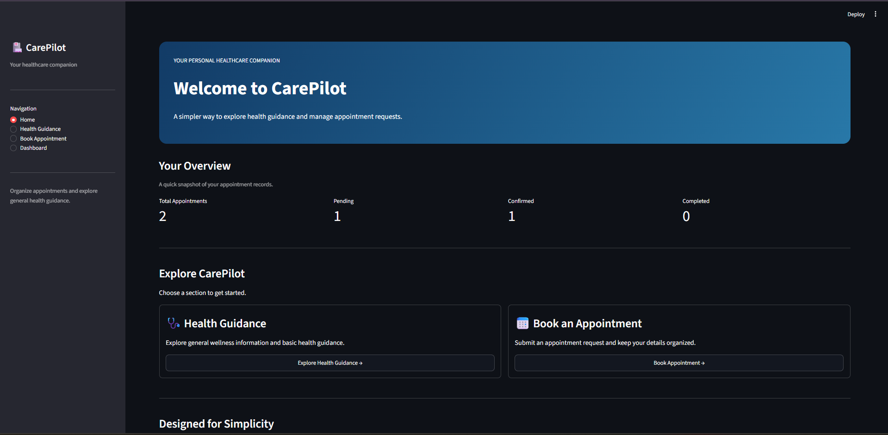
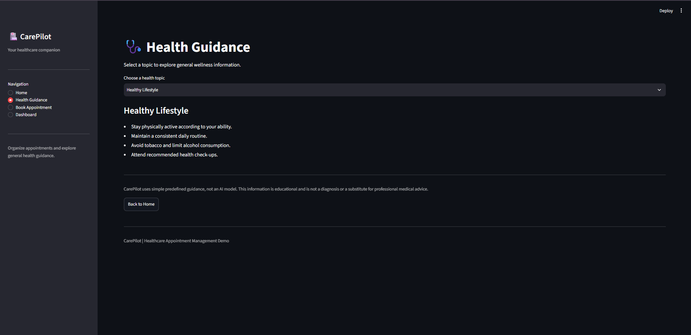
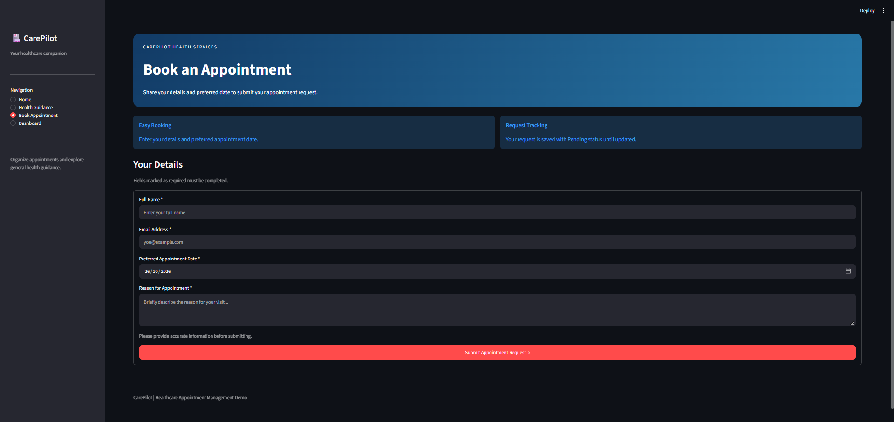
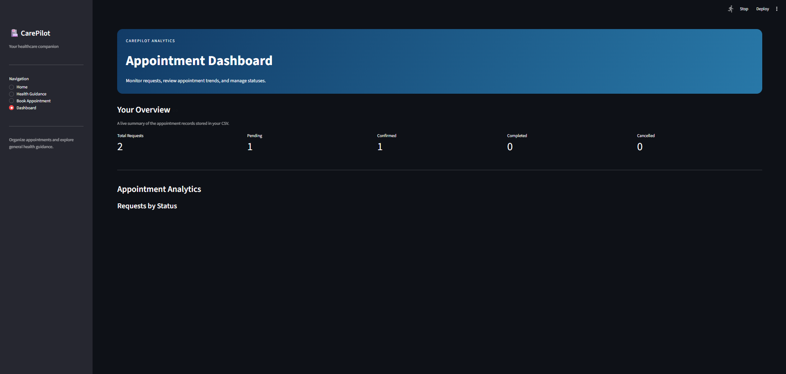

# CarePilot — AI Healthcare Assistant

CarePilot is a healthcare assistant prototype built with Python and Streamlit. It provides a simple interface for exploring rule-based health guidance, submitting appointment requests, and viewing appointment information through a dashboard.

> **Disclaimer:** CarePilot is a demonstration project, not a medical device or diagnostic system. Its health guidance uses basic keyword-based rules and is not a substitute for professional medical advice. In an emergency, contact local emergency services.

## Features

- **Home:** Navigate between the application's main sections.
- **Health Guidance:** Receive basic, rule-based guidance based on entered symptoms or keywords.
- **Book Appointment:** Submit an appointment request through the application.
- **Dashboard:** View appointment statistics and manage appointment statuses.
- **Local persistence:** Appointment requests are stored in a CSV file.
- **Data export:** Download appointment data where supported by the dashboard.

## Screenshots

### Home Page


### Health Guidance


### Book Appointment


### Dashboard


## Tech Stack

- Python
- Streamlit
- Pandas
- CSV-based local storage
- Git and GitHub

## Run Locally

### 1. Clone the repository

```bash
git clone https://github.com/adityadhawle/carepilot-healthcare-assistant.git
cd carepilot-healthcare-assistant
```

### 2. Create and activate a virtual environment

**Windows PowerShell:**

```powershell
py -m venv .venv
.\.venv\Scripts\Activate.ps1
```

### 3. Install dependencies

```powershell
python -m pip install streamlit pandas
```

### 4. Start the application

```powershell
python -m streamlit run app.py
```

Open the local URL shown in the terminal, usually `http://localhost:8501`.

## Data and Privacy

Appointment data is stored locally in the application's `data/` directory as a CSV file. This prototype does not provide production-grade authentication, access control, or secure healthcare data management.

Use only fictional or appropriately anonymized information when testing or demonstrating the application. Do not commit real patient information, appointment records, credentials, or secrets to a public repository.

## Project Structure

```text
carepilot-healthcare-assistant/
├── app.py
├── README.md
├── .gitignore
└── screenshots/
    ├── home.png
    ├── health-guidance.png
    ├── book-appointment.png
    └── dashboard.png
```

## Future Improvements

- Integrate a validated AI model for health-related information.
- Add secure authentication and role-based access.
- Use a database with appropriate access controls.
- Improve input validation, automated testing, and error handling.

## Author

**Aditya Dhawle**

[GitHub Repository](https://github.com/adityadhawle/carepilot-healthcare-assistant)
